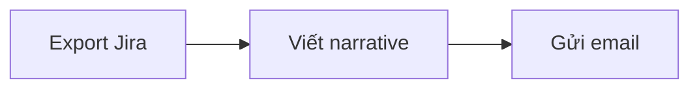

# Submission

## Loại bài

**Cá nhân + Nhóm.** Một phần làm cá nhân (CP1, CP2, CP7), một phần làm theo nhóm 3–4 người (CP3–CP6).

**Mỗi nhóm sẽ làm chung một repo do nhóm trưởng fork về, mỗi học viên sẽ submit repo nhóm mình trên LMS bằng tài khoản của mình**.

## Tên repo

### Repo đề bài

```text
https://github.com/VinUni-AI20k/K5-L3-Day02-DiscoveryProblemFraming.git
```

### Repo bài nộp

Mỗi nhóm làm chung **một** repo. Nhóm trưởng fork repo đề bài và đặt tên theo cú pháp sau. `TenNhom` là tên nhóm, viết không dấu, không khoảng trắng. Không dùng họ tên hay MSSV của nhóm trưởng hay của từng thành viên.

```text
K5-<L3A hoặc L3B>-DAY02-TenNhom-DiscoveryProblemFraming
```

Ví dụ lớp L3A: `K5-L3A-DAY02-NhomABC-DiscoveryProblemFraming`. Lớp L3B: `K5-L3B-DAY02-NhomABC-DiscoveryProblemFraming`.

Quy tắc: viết không dấu, không khoảng trắng, các phần ngăn cách bằng dấu `-`, ngày học dùng hai chữ số (`DAY02`). Mỗi thành viên vẫn nộp **đúng link repo này** lên LMS bằng tài khoản của mình. Không fork thêm repo cá nhân.

## Cấu trúc và file phải nộp

```text
K5-<L3A hoặc L3B>-DAY02-TenNhom-DiscoveryProblemFraming/
├── README.md, RULES.md, CHECKPOINTS.md, RUBRIC.md, SUBMISSION.md   ← giữ nguyên
├── TEAM.md                                  ← BẮT BUỘC: bản chung của nhóm
├── report/
│   ├── individual/
│   │   ├── 20241234_NguyenVanAn.md          ← BẮT BUỘC: mỗi thành viên một file
│   │   └── 20245678_TranThiBinh.md
│   ├── team/
│   │   └── group_report.md                  ← BẮT BUỘC: một bản trên repo chung
│   └── assets/                              ← ảnh quy trình, Mermaid, ảnh survey, snapshot
├── docs/                                    ← giữ nguyên
└── src/                                     ← giữ nguyên (lab không có code)
```

### Phần cá nhân

- Mỗi thành viên có một file riêng trong `report/individual/` trên repo chung. Copy template `MSSV_HoTen.md` thành file mới, đặt tên bằng MSSV và họ tên không dấu của chính mình, ví dụ `report/individual/20241234_NguyenVanAn.md`. Giữ template cho đến khi mọi người đã copy xong, rồi xóa template.
  - **Đúng:** `20241234_NguyenVanAn.md` (MSSV trước, dấu gạch dưới `_`, họ tên viết liền không dấu).
  - **Sai:** `MSSV_HoTen.md` (chưa đổi tên), `NguyenVanAn_20241234.md` (đảo thứ tự), `20241234-NguyenVanAn.md` (sai dấu nối).
  - **Tên repo** dùng tên nhóm (`TenNhom`), không dùng họ tên hay MSSV. Hai quy tắc này độc lập với nhau.
- Điền đủ các mục 1–6 trong file của bạn. Commit bằng tài khoản GitHub của chính bạn. Không viết hộ người khác.

### Phần nhóm

- `report/team/group_report.md`: nhóm viết chung một bản ngay trên repo nhóm.
- `TEAM.md`: nhóm điền thông tin chung trên repo đó; **mỗi người tự điền phần cá nhân của mình**.

### File phụ

Đặt trong `report/assets/`, tên file bắt đầu bằng số checkpoint, ví dụ:

```text
report/assets/cp2-workflow-card-1.png
report/assets/cp4-interview-snapshot-1.md
report/assets/cp5-workflow-future.png
```

Dẫn link ảnh từ báo cáo, ví dụ ``.

**Sơ đồ Mermaid:** viết thẳng một khối code có nhãn `mermaid` trong báo cáo, GitHub sẽ tự hiển thị thành sơ đồ. Không lưu thành file `.mmd` rồi chèn bằng cú pháp ảnh ``, vì GitHub không hiển thị được kiểu đó.

```markdown

```

## Nơi nộp

Mỗi thành viên nộp **cùng một link** — link repo do nhóm trưởng fork — trên LMS, mục bài nộp Day 02, bằng tài khoản LMS của mình. Không tạo Pull Request về repo gốc. Không nộp repo cá nhân.

Nhóm trưởng vào **Settings → Collaborators**, mời các thành viên để cùng commit. Repo fork có cùng chế độ public/private với repo gốc; nếu fork là private, thêm coach làm collaborator theo hướng dẫn trên LMS để coach chấm được.

## Deadline (GMT+7)

- Lab **sáng**: nộp trước **23h59 GMT+7** ngày lab.
- Lab **chiều/tối**: nộp trước **11h59 GMT+7** ngày hôm sau.
- Key coach có thể gia hạn tối đa 48 giờ nếu có lý do chính đáng. Thông báo gia hạn đăng trên LMS.
- Commit sau deadline (hoặc sau hạn gia hạn, nếu được gia hạn) không được chấm. Không có hình thức "nộp muộn bị trừ điểm".

## Checklist trước khi nộp

- [ ] Nhóm chỉ có một repo, do nhóm trưởng fork từ repo đề bài. Tên đúng mẫu `K5-<L3A hoặc L3B>-DAY02-TenNhom-DiscoveryProblemFraming`: `TenNhom` là tên nhóm, `L3A` hoặc `L3B` đúng lớp.
- [ ] Bạn đã có file báo cáo cá nhân đúng tên (ví dụ `report/individual/20241234_NguyenVanAn.md`) và điền đủ mục 1–6. Template `MSSV_HoTen.md` đã được xóa sau khi mọi người có file riêng.
- [ ] Bảng scan có ít nhất 5 problem dạng Job Story (CP1).
- [ ] Có 3 Problem Card và 3 quy trình nháp (CP2).
- [ ] `report/team/group_report.md` và `TEAM.md` đã điền trên repo nhóm.
- [ ] Phần của bạn trong `TEAM.md` đã điền.
- [ ] Mọi ảnh và file phụ nằm trong `report/assets/` và hiển thị được khi mở báo cáo trên GitHub.
- [ ] Mọi link trong bảng research mở được.
- [ ] Không có thông tin cá nhân của người được phỏng vấn, API key hay file `.env`.
- [ ] Bạn đã nộp đúng link repo nhóm trên LMS bằng tài khoản của mình, trước deadline.
